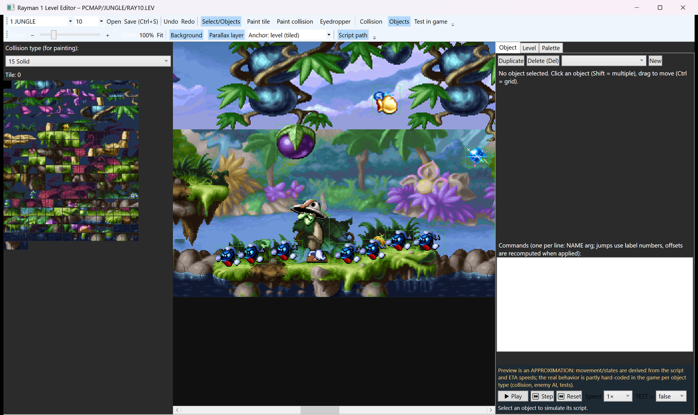
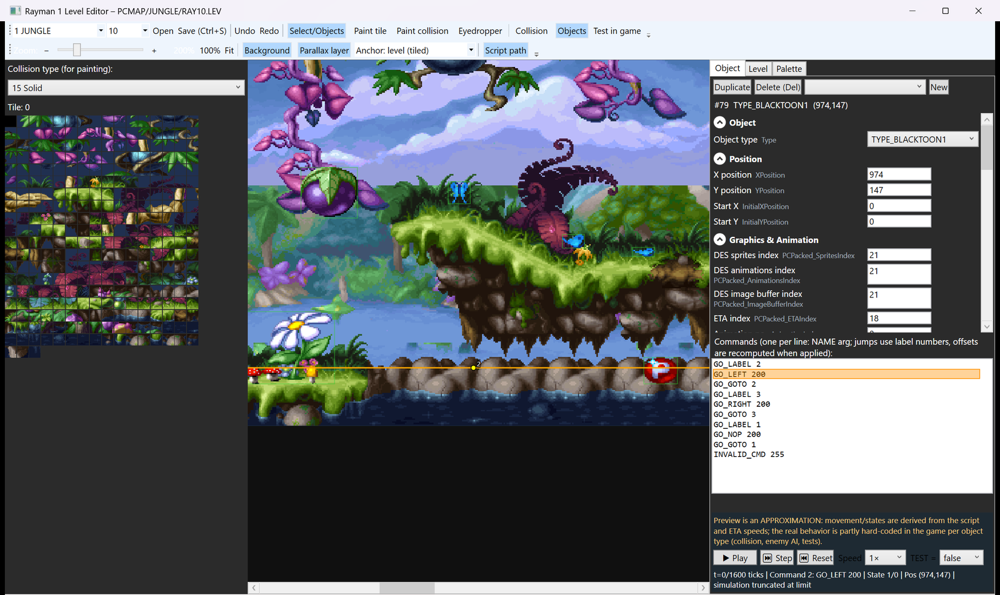
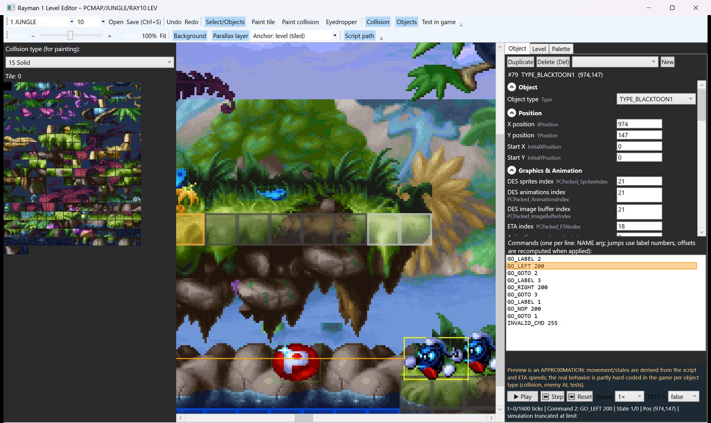
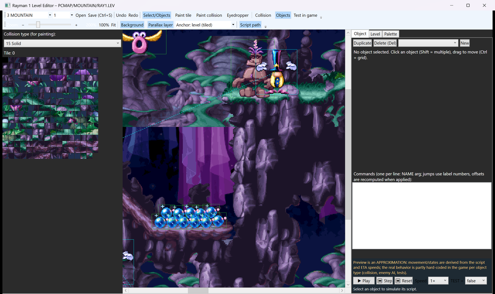

# Ray1 Level Editor

Unofficial visual level editor for **Rayman 1 (PC / DOS version, e.g. GOG "Rayman Forever")**, written in WPF / .NET 8.

> **Disclaimer.** This is an unofficial fan tool. It is not affiliated with, endorsed by or connected to Ubisoft. *Rayman* is a trademark of Ubisoft Entertainment. **This repository contains no game files** (no levels, graphics, sounds or executables). You need your own legally purchased copy of the game; the editor works on a copy of its `PCMAP` folder.

## Screenshots


*Level overview (Jungle) with background layer and object boxes.*


*A selected object with the grouped, labeled property panel and its command script.*


*Approximate script preview: path overlay and the currently executed command highlighted.*


*Zoomed to 400 % with the collision overlay.*


*Another world (Mountain) with objects and link lines.*

*The screenshots show game graphics from Rayman (© Ubisoft) solely to illustrate the editor.*

## Features

- Tile map view with the real tile graphics and palette; **tile painting** (tile palette, eyedropper) and **collision painting** with an overlay
- **Objects** with real sprites: select, move (Ctrl = grid), multi-select, duplicate, delete, create from a template of a type used in the level
- **All object properties**, grouped and labeled with tooltips (source notes in [docs/OBJ-FIELDS.md](docs/OBJ-FIELDS.md)); runtime-only values are marked
- **Link groups** (objects that are activated/restarted together)
- **Script editor**: command scripts as text, jumps via label numbers; label offsets are **recompiled automatically** on apply/save, errors are shown per line
- **Approximate script preview**: simulated movement path and animation from the script and ETA speeds (play/step/reset)
- **Zoom** 25-800 % (Ctrl+wheel, keys, slider, fit), panning
- **Level background / parallax** (VIGNET.DAT PCX images, three anchoring modes)
- Level properties and palette editor
- **Undo / redo**
- **Test in DOSBox** (saves, then starts the game from the test copy)

## Format documentation

- [docs/LEV-FORMAT.md](docs/LEV-FORMAT.md) - layout of the PC `.LEV` level files
- [docs/OBJ-FIELDS.md](docs/OBJ-FIELDS.md) - object (`ObjData`) fields: names, groups, meaning, runtime vs. start values

## Build

Requirements: Windows, [.NET 8 SDK](https://dotnet.microsoft.com/download/dotnet/8.0).

```
git clone https://github.com/smicbee/ray1-level-editor
cd ray1-level-editor
dotnet build Ray1LevelEditor -c Release
# or a framework-dependent publish:
dotnet publish Ray1LevelEditor -c Release -o publish
```

## Usage

1. Make a **working copy** of your Rayman game folder (the editor writes `.LEV` files in place - never point it at your only copy).
2. Point the editor to the copy's `PCMAP` parent folder (the folder containing `PCMAP\JUNGLE\RAY1.LEV` etc.): by default `C:\GOG Games\Rayman Forever - Editor Test\Rayman`; override with the environment variable `R1ED_ROOT`.
3. Run `Ray1LevelEditor.exe`, pick world and level, edit, **Save (Ctrl+S)**. "Test in game" starts DOSBox from the sibling `DOSBOX` folder of the GOG layout.

Saving serializes to a temporary file, re-reads it for validation and only then replaces the level.

Optional environment variables `R1ED_*` (zoom, selection, scroll, ...) exist for automated screenshot tests; they have no effect when unset.

## Other projects in this repository

- `RoundTrip/` - reads every `RAY*.LEV` and writes it back, compares bytes: `dotnet run --project RoundTrip -- <PCMAP dir> <out dir>`
- `EditTest/` - headless edit test (adds a sky platform); only touches a test copy
- `Probe/` - small format exploration tool

## Verification

- Round trip (read -> write) of all **82 / 82 PC levels** of the GOG version v1.21 is **byte-identical** (requires the padding patch in the vendored serializer, see [THIRD-PARTY-NOTICES.md](THIRD-PARTY-NOTICES.md)).
- Edited levels were checked to load in DOSBox (see `docs/EditTest-SkyPlatform.cs.txt`).

## Known limitations

- No new graphics, no tile-set / sprite editing, no `.WLD` / `ALLFIX.DAT` editing (only existing tiles can be painted)
- The script preview is an **approximation**: real behavior is partly hard-coded per object type in the game (collision, enemy AI, tests)
- The speed unit in the preview (1/16 px per tick) is an assumption, not verified against the engine
- Mouse interactions (dragging, painting, group expanders) are only partly tested; object-field semantics come from the PS1 decompilation and were not separately verified for the PC version
- Only the Rayman 1 PC main game (v1.21 layout) is targeted

## Credits

- [RayCarrot](https://github.com/RayCarrot): [BinarySerializer](https://github.com/RayCarrot/BinarySerializer) / BinarySerializer.Ray1 / BinarySerializer.PlayStation (MIT, vendored in `ext/`), [Ray1Map](https://github.com/RayCarrot/Ray1Map) and [Ray1Editor](https://github.com/RayCarrot/Ray1Editor) for format knowledge
- [fuerchter/rayman-ps1-decomp](https://github.com/fuerchter/rayman-ps1-decomp) for engine behavior reference
- The Rayman community for years of reverse-engineering work

## License

The editor code is released under the [MIT License](LICENSE) (c) 2026 Michael Beetz. Vendored third-party code in `ext/` keeps its own MIT licenses ([THIRD-PARTY-NOTICES.md](THIRD-PARTY-NOTICES.md)). This license does not cover Rayman or any Ubisoft content.
